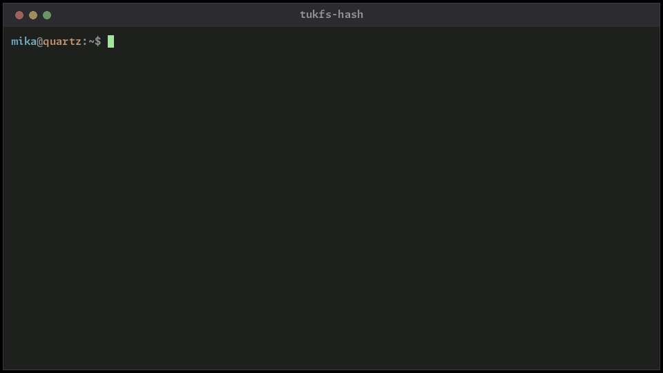

<!-- markdownlint-disable MD007 -- Unordered list indentation -->
<!-- markdownlint-disable MD010 -- No hard tabs -->
<!-- markdownlint-disable MD033 -- No inline html -->
<!-- markdownlint-disable MD041 -- First line in a file should be a top-level heading -->

<!-- TOC ignore:true -->
# tukfs-hash

Checksums every file on a Linux box, remembers what each one read as, and says when a file's contents changed while its size and modified time didn't. That is what bad RAM, a bad cable or a filesystem bug leaves behind. A normal edit always moves the time.

It's a utility under tukfs, part of tukzedo.

<!--  -->

<!-- TOC ignore:true -->
## Table of contents

<!-- TOC -->

- [What it does](#what-it-does)
- [Attributes](#attributes)
- [Usage](#usage)
- [Set up development environment](#set-up-development-environment)
- [Copyright and license](#copyright-and-license)

<!-- /TOC -->

## What it does

- Reads each regular file once with blake3. Files that already have a current rmlint blake2b checksum get blake2b too, from the same read. With `--rmlint` every file it reads gets blake2b, kept in the database, and rmlint's own attributes are written where they're missing or out of date.

- Compares the result with 3 earlier records, when they're there and the size and time still match:
	- The blake3 left on the file in extended attributes, by this program or by nemo-anywhere.
	- rmlint's blake2b, in `user.rmlint.blake2b.*`.
	- Its own database from earlier runs.

- Reads a file again, with its cache dropped, when it doesn't match. If the second read does, only memory was wrong, and that's logged as a `cache-mismatch`. If not, the stored checksums are kept as they were, so every later run reports the file until it's fixed or accepted. ZFS keeps its own cache and ignores the request to drop it, so there the second read can't tell memory from disk.

- Writes the blake3 back onto the file, in the attributes nemo-anywhere reads, plus the date it was taken and the inode it came from. Files in git work trees get none, since git already checksums what it keeps. Files on NTFS, APFS or HFS+ get none either, since Linux's drivers for those aren't reliable enough to write with. They're still read and recorded, and the database can't go on one.

- Keeps everything in one SQLite file, which can be copied or archived as is.

- Runs one worker per set of disks, so no disk is read by two at once, and more on flash. It never crosses into another mount or btrfs subvolume.

- Stops cleanly on Ctrl+C and picks up where it left off with `--resume`. A file read since the start of the day, or since `--since`, isn't read again. `--resume` only takes the newest scan, and only with the same roots and the same `--verify` or not, so 2 scripts sharing one database can't finish each other's runs.

- `scan --verify` is a quicker check between full runs. It reads again only the files with a checksum stored at their current size and time, even ones read earlier that day, and leaves no attributes. New and edited files wait for the next full scan.

- `gone` lists the names a finished scan didn't see, which mostly means deleted files. `prune` drops the contents no name points at any more, since every edit leaves one behind.

- `snapdiff` takes the change list from `zfs diff` or `btrfs subvolume find-new` and flags files that changed between 2 snapshots with the same size and time.

## Attributes

| Name                  | Value
| :---                  | :---
| `user.blake3.b64u`    | blake3-256, base64url with no padding
| `user.blake3.bytes`   | size when it was taken
| `user.blake3.date`    | when it was taken, microseconds since 1970
| `user.blake3.mtime`   | modified time when it was taken, microseconds since 1970
| `user.blake3.inode`   | `device:inode:checksum` of the file it was taken from

A reader trusts the checksum only when both the size and time match the file. The time is written after the checksum and the inode last, so a write that stops part way is thrown away.

A file is skipped without reading only when `user.blake3.inode` matches the file's own device and inode and the checksum next to it. A copy made with `cp -a` or `rsync -aX` brings the attributes along, so it gets read and compared. Attributes from before `user.blake3.inode` existed never skip.

With `--rmlint`, `user.rmlint.blake2b.cksum` and `user.rmlint.blake2b.mtime` are written the same way `rmlint --xattr` writes them, so rmlint can use them without reading the file. One that's current and doesn't match is reported, and left as it was. blake2b is slower than blake3, about a CPU second per GB, which only shows when the disk is faster than that.

Writing an attribute changes the file's ctime, and Linux has no way to set it back.

## Usage

~~~text
tukfs-hash scan --db FILE --root DIR [--root DIR ...] [options]
tukfs-hash plan --root DIR [--root DIR ...] [--threads DIR=N ...]
tukfs-hash runs --db FILE
tukfs-hash report --db FILE [--run N] [--kind KIND] [--limit N]
tukfs-hash gone --db FILE [--run N] [--limit N]
tukfs-hash accept --db FILE PATH...
tukfs-hash prune --db FILE
tukfs-hash snapdiff --old DIR --new DIR (--zfs-diff FILE --mount DIR | --find-new FILE | --list FILE) [--all]
~~~

`tukfs-hash --help` has the options. `report` and `gone` list 200 lines unless `--limit` says otherwise, and say on stderr how many were left off. `snapdiff --all` also lists the files that didn't change. Run `scan` as root to reach every file. The database is handed back to the user who ran sudo when the run ends.

`accept` reads each file twice and takes what it reads as now as good. It's for a file changed on purpose with its time put back, or one restored from a backup and checked by hand. It replaces the database record and any blake3 already on the file, and removes rmlint's blake2b if that no longer matches. On NTFS, APFS or HFS+ only the database record changes. Each name of a hard-linked file has its own record, so name each one.

`gone` takes the newest finished scan, or run N, and lists the names under its roots that it didn't see. A name with an error in that run, or under a folder it couldn't list, isn't counted, and neither is one last seen from a deeper root by another run, since that may be a mount the walk stops at. A folder left out with `--exclude` does count as not seen.

Exit codes: 0 fine, 1 error, 2 stopped, 4 mismatches or read errors found, 8 some files or folders couldn't be checked, or input wasn't understood (snapdiff). 2, 4 and 8 add up, so 6 is a stop after a mismatch and 12 is both kinds found. A resumed scan counts what its earlier parts found too. `accept` exits 1 if any file wasn't taken. A second Ctrl+C ends a scan at once, with 130. A root that can't be resolved is an error, and nothing is read.

Names that aren't plain text are printed with `\xHH` escapes, and a backslash as `\\`, so 2 names never print the same.

## Set up development environment

~~~bash
cargo build --release
tests/integration.bash
~~~

The integration test needs `sqlite3`, `getfattr`, `setfattr`, `b2sum` and `python3`, and a `HOST_TEMP`, or else a `TMPDIR`, on a filesystem with user xattrs. It works in a folder of its own under `tukfs-hash/` there, and `--keep-temp` keeps it.

`rust-toolchain.toml` pins the Rust toolchain, and only rustup's `cargo` reads it. `cicd/cicd.bash` runs the whole local pipeline: format, build, lint, tests, release builds for x86_64 and arm64 Linux with a `.deb` and an `.rpm` of each, dogfood, the demo gif above, and publish. The release builds run in a Debian 10 image under docker, so each one needs only glibc 2.28 or newer. The test steps that run on the box, such as the integration test, run in a bubblewrap sandbox that can write only to their own temp and build folders, so the pipeline needs `bwrap`. `--no-sandbox` runs them without it. Without docker, or with `--no-container`, only the x86_64 one builds, on the box, and it needs the box's glibc. Where an arm64 Linux test VM is set up, the arm64 build's unit and integration tests also run there. A VM that isn't there is skipped, and `--no-remote` skips it on purpose. The gif needs Pillow, and is skipped without it. `cicd/cicd.bash --merge-gate` runs every check without publishing anything, and the pre-push hook runs it on pushes to `main` after `git config core.hooksPath cicd/hooks`. Pushes that only change docs skip it. `--help` lists the rest.

A full run also has the leak and memory checks: the tests under ASan, TSan and Miri on the nightly that `cicd/tool-pins.env` names, a heap soak of repeated scans, fuzz tests of the parsers, CodeQL over every crate, and `cargo deny check advisories`. The sanitizers, Miri and CodeQL run in a docker image built from `cicd/container/` the first time, which takes a few minutes and about 4 GB. Without docker they use the host's nightly, and CodeQL is skipped. `--quick` keeps the ones that take under a minute, and any that take hours run only with `--long`. `--no-leakcheck` leaves them all out, and `--no-codeql` only CodeQL.

Release builds are reproducible: 2 builds of one commit give the same bytes, packages included, wherever the checkout is.

## Copyright and license

> Copyright © 2026 t00mietum (CryptogID: ปʬϝღถɔ4რఠΔթะ9ƾǝu) 
> Licensed under [GPL-2.0](license.md). No warranty.
